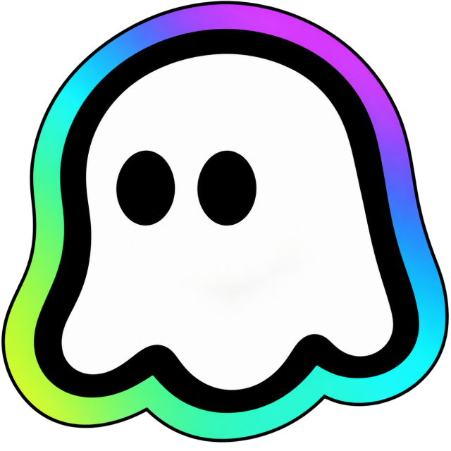

 

###  Sobre mim

Me chamo **Rafael Machado**.

Sou desenvolvedor de software em formação e uso este espaço para compartilhar alguns dos projetos que estou criando enquanto aprendo programação.

Gosto principalmente de pegar uma ideia e tentar transformar ela em algo que realmente funcione. Durante esse processo, vou aprendendo mais sobre organização de código, estrutura de projetos e desenvolvimento no geral.

Atualmente estudo e desenvolvo projetos principalmente com **Python, JavaScript e desenvolvimento web**.

 

###  Tecnologias

<table>
  <tr>
    <td><strong>Backend</strong></td>
    <td>Python · Node.js</td>
  </tr>
  <tr>
    <td><strong>Frontend</strong></td>
    <td>HTML · CSS · TypeScript</td>
  </tr>
</table>

Ainda estou aprendendo e expandindo minha stack, mas procuro entender bem o que estou usando em cada projeto.

 

###  Projetos em destaque

  

    <strong>Kiaguri</strong>
    &nbsp;
    <code>Python</code>
    <code>Ativo</code>
     
    Bot para Discord · Sempre Atualizando
  

 

<table>
<tr>
<td>

<h4>
  
  Kiaguri
</h4>

<strong>Uma companhia de outro mundo para o Discord.</strong>

A <strong>Kiaguri</strong> surgiu da ideia de criar um bot que reunisse várias funcionalidades úteis em um só lugar, sem precisar depender de vários bots diferentes no servidor.

O objetivo é deixar a experiência mais simples tanto para quem administra quanto para quem usa o servidor.

Esse também é o projeto onde mais pratico programação atualmente. Sempre que aprendo algo novo, tento aplicar no bot, melhorar partes antigas e adicionar novas funcionalidades.

<strong>Principais objetivos do projeto:</strong>

<ul>
  <li>Reunir funcionalidades úteis em um único bot;</li>
  <li>Facilitar a administração de servidores;</li>
  <li>Adicionar e melhorar recursos aos poucos;</li>
  <li>Usar o projeto como forma de aprendizado.</li>
</ul>

  <strong>Tecnologia principal:</strong> Python 
  <strong>Plataforma:</strong> Discord 
  
  <a href="https://discord.com/oauth2/authorize?client_id=1494057977550995576"><strong>Adicionar Bot</strong></a>

  <video
    src="https://github.com/user-attachments/assets/ed062040-962d-4353-a9d7-8927f535e80c"
    width="620"
    controls>
  </video>

</td>
</tr>
</table>

 

  

    <strong>Lúmina</strong>
    &nbsp;
    <code>HTML</code>
    <code>CSS</code>
    <code>TS</code>
    <code>JS</code>
     
    Site com objetivo acadêmico
  

 

<table>
<tr>
<td>

  

<h3 align="center">Lúmina</h3>

  
  
  
  

  

---

### Sobre

A Lúmina Educação nasceu a partir de um trabalho de IFA de Matemática com uma proposta simples: criar uma empresa fictícia e desenvolver um produto que ainda não existe.

A partir disso, pensamos em um problema real da educação e criamos o HoloTutor, um conceito de professor holográfico com inteligência artificial e uma base móvel capaz de circular pela sala de aula.

O objetivo do trabalho era imaginar uma empresa, identificar um problema e apresentar uma solução para ele.

Nossa ideia partiu de uma situação comum dentro da sala de aula: um professor precisa acompanhar vários alunos ao mesmo tempo, mas cada estudante pode ter uma dúvida diferente.

  <strong>Tecnologias principais:</strong> HTML, CSS, JavaScript, React e TypeScript

  <a href="https://github.com/yT1X/lumina"><strong>Repositório do projeto</strong></a> · 
  <a href="https://luminaeducaa.vercel.app"><strong>Projeto online</strong></a>

</td>
</tr>
</table>

 

  

    <strong>Color Selector</strong>
    &nbsp;
    <code>HTML</code>
    <code>CSS</code>
    <code>JS</code>
    <code>Canvas API</code>
     
    Site com objetivo publico
  

 

<table>
<tr>
<td>

  

<h3 align="center">Color Selector</h3>

  
  
  
  
  

---

### Sobre

O Color Selector é um site que permite identificar e copiar cores diretamente de qualquer imagem. Basta enviar uma imagem e clicar no ponto que deseja para descobrir exatamente qual é a cor daquele pixel.

Além de mostrar os códigos HEX, RGB, RGBA, HSL e HSLA, o site conta com ferramentas de zoom e movimentação da imagem, histórico das cores selecionadas e opção de exportar essas informações em TXT ou JSON.

A ideia do projeto é tornar a identificação de cores algo simples e prático, reunindo tudo o que é necessário em um só lugar.

  <strong>Tecnologias principais:</strong> HTML, CSS, JavaScript e Canvas API

  <a href="https://t1xcolor.vercel.app"><strong>Projeto online</strong></a>

</td>
</tr>
</table>

 

###  Contato

Quer conversar sobre algum dos meus projetos ou sobre alguma oportunidade? Fique à vontade para entrar em contato.

  <a href="mailto:contato.rafaelfiais@gmail.com">E-mail</a> ·
  <a href="https://www.linkedin.com/in/rafaelmachadofiais/">LinkedIn</a> ·
  <a href="https://discord.gg/pTpR9du4qP">Discord</a>

 

  <strong>T1X · Uma ideia, algumas linhas e um novo aprendizado.</strong>
   
  ✧

